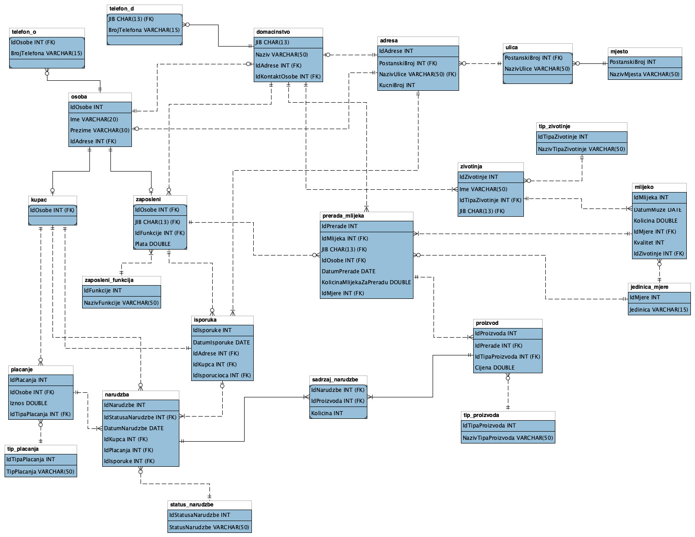

# 🌾 Agricultural Household Information System "ATOM"

## 📖 About the Project

**"ATOM" Information System** is a comprehensive software solution developed as a project assignment for the **Database Systems** course at the Faculty of Electrical Engineering, University of Banja Luka.

The goal of the system is the digitization and centralized management of business and production processes for an agricultural household engaged in livestock farming, production, processing, and sales of homemade dairy products (cheese, kajmak, milk, yogurt, sour cream).

The system covers the complete production and sales cycle:
- **Household and Resource Records**: Tracking household data, locations, and contact information.
- **Human Resources (Staff Records)**: Managing employees, their assigned roles (milking, processing, delivery), and salaries.
- **Livestock and Raw Material Base**: Tracking animals (cows, goats) and recording daily milking logs (quantity, quality, date).
- **Production Facility**: Tracking milk processing operations and resulting finished products along with their pricing.
- **Sales and Distribution**: Managing customers, creating orders, order item specifications, payment processing, and delivery logistics.
- **Business Analytics**: Generating reports on milk yield per animal, top-selling products, and total household revenue/profit.

---

## 🏛 System Architecture

The application is implemented using a multi-tiered architecture that decouples the user interface, business logic, and data access layers:

```
┌────────────────────────────────────────────────────────┐
│             Presentation Layer (JavaFX GUI)            │
│       FXML Views + CSS Styling + MVC Controllers       │
└───────────────────────────┬────────────────────────────┘
                            │
┌───────────────────────────▼────────────────────────────┐
│                 Business Layer (Core)                  │
│       Entity Models + DTO Objects + Service Logic      │
└───────────────────────────┬────────────────────────────┘
                            │
┌───────────────────────────▼────────────────────────────┐
│               Data Access Layer (DAO)                  │
│  DataAccessFactory ──► MySQLDataAccessFactory          │
│  DAO Interfaces    ──► MySQL DAO Implementations       │
│  Thread-Safe ConnectionPool                            │
└───────────────────────────┬────────────────────────────┘
                            │ JDBC Connection
┌───────────────────────────▼────────────────────────────┐
│               Persistence Layer (MySQL)                │
│    Tables, Relations, Integrity, Procedures, Triggers  │
└────────────────────────────────────────────────────────┘
```

### Key Design Patterns and Components:
- **DAO (Data Access Object) Pattern**: Complete encapsulation of SQL operations through dedicated interfaces (`OsobaDataAccess`, `DomacinstvoDataAccess`, `NarudzbaDataAccess`, etc.).
- **Abstract Factory Pattern**: `DataAccessFactory` enables flexible swapping of data sources (e.g., migrating to another database engine).
- **Thread-Safe Connection Pool**: Custom connection pool (`ConnectionPool`) optimizing JDBC connection reuse and minimizing database overhead.
- **Separation of Concerns**: FXML defines UI structure, CSS defines visual styling, while controllers handle user interactions and communicate with the DAO layer.

---

## 🗄 Conceptual and Relational Database Model

The `inf_sis_atom` database is designed in compliance with the Third Normal Form (3NF), ensuring data integrity and consistency.

<p align="center">
  
</p>

### Main Database Entities:
| Entity | Description |
|---|---|
| `domacinstvo` | Basic agricultural household records (tax identification number / JIB, name, address, contact person) |
| `osoba` / `telefon_o` | Generalized individual records (contact persons, employees, customers) |
| `zaposleni` / `zaposleni_funkcija` | Household workers, their assigned roles (milking, processing, delivery), and salaries |
| `zivotinja` / `tip_zivotinje` | Milking livestock records (cows, goats) and household ownership |
| `mlijeko` / `jedinica_mjere` | Milking logs (date, quantity, unit of measure, quality score 1–5, animal) |
| `prerada_mlijeka` | Processing operations for raw milk batches handled by assigned workers |
| `proizvod` / `tip_proizvoda` | Finished dairy products (cheese, kajmak, yogurt, milk, sour cream) with defined prices |
| `kupac` | Customer records with associated residential addresses and phone numbers |
| `narudzba` / `status_narudzbe` | Orders, timestamps, and order statuses (e.g., paid, unpaid) |
| `sadrzaj_narudzbe` | Order line items linking orders and products with corresponding quantities |
| `placanje` / `tip_placanja` | Payment transactions (amount and payment type: cash, card) |
| `isporuka` | Delivery logistics to customer addresses, assigned to a specific delivery employee |
| `mjesto`, `ulica`, `adresa` | Normalized geographic hierarchy of locations, streets, and addresses |

---

## ⚡ Stored Procedures, Views, and Triggers

The script [`skripte/ddl_procedure_triger_pogled.sql`](skripte/ddl_procedure_triger_pogled.sql) contains advanced database routines and objects:

1. **View `kolicina_mlijeka_po_zivotinji`**:
   - Aggregates and displays the total milk yield per animal by joining animal details, species type, and milking logs.

2. **Stored Procedure `top_proizvodi_domacinstva`**:
   - Parameters: `(IN p_jib CHAR(13), IN p_limit INT)`
   - Returns the best-selling products for a given household ordered by units sold and total revenue, filtering for paid orders only.

3. **Stored Procedure `ukupna_dobit_domacinstva` (with SQL Cursor)**:
   - Parameters: `(IN pIdStatusa INT, IN p_jib CHAR(13), OUT p_dobit DOUBLE)`
   - Uses an **SQL cursor** (`narudzbe_cursor`) to iterate through orders of a specific status (e.g., paid), dynamically calculate the sum of items per order, and compute the total profit/revenue for the household.

4. **Trigger `narudzba_default_status_trigger`**:
   - `BEFORE INSERT ON narudzba`
   - Automatically assigns status `2` ("unpaid") to newly created orders when no status is explicitly provided.

---

## 💻 Application Features

The application provides an intuitive graphical user interface with a comprehensive set of features:

- **Dashboard (Home Screen)**: Quick navigation across all system modules.
- **Household Module**: View and update core farm information and contact details.
- **Employees Module**: Full CRUD operations for farm workers, job role assignments (milking, processing, delivery), and salary management.
- **Livestock Module**: Record and manage dairy animals (cows, goats) assigned to the household.
- **Milking (Raw Milk) Module**: Daily milking data entry, quality rating (1–5), volume, and timestamp recording.
- **Milk Processing Module**: Track raw milk consumption for product manufacturing and assign responsible personnel.
- **Products Module**: Finished product catalog with pricing per item / liter / kilogram.
- **Customers Module**: Client directory with addresses and contact phone numbers.
- **Orders & Line Items Module**: Create new orders, add products to cart, and track payment statuses.
- **Deliveries Module**: Schedule deliveries to customer addresses with designated couriers.
- **Reports & Analytics Module**:
  - View total milk yields per animal (via database view).
  - View Top 5 best-selling dairy products (via stored procedure).

---

## 📁 Repository Structure

```text
.
├── .gitignore                                  # Root configuration for ignoring temporary and sensitive files
├── README.md                                   # Project documentation
├── specifikacija_informacionih_potreba.pdf     # Official project requirements and specifications document
├── konceptualni_model/
│   ├── KonceptualniModel_inf_sis_atom.mwb      # MySQL Workbench source model
│   └── KonceptualniModel_slika.png             # Graphical ER diagram export
├── skripte/
│   ├── ddl_inf_sis_atom.sql                    # SQL DDL script for database schema and table creation
│   ├── data_inf_sis_atom.sql                   # SQL script populated with sample test data
│   └── ddl_procedure_triger_pogled.sql         # SQL script containing stored procedures, triggers, and views
└── pilot_aplikacija/
    ├── BP_PROJEKTNI_ZADATAK/                   # Business and DAO layer (Java backend + unit tests)
    │   └── src/
    │       ├── module-info.java
    │       └── org/unibl/etf/
    │           ├── dao/                        # DAO interfaces and DataAccessFactory
    │           │   └── mysql/                  # MySQL DAO implementations
    │           │       ├── ConnectionPool.java # Custom connection pool management
    │           │       └── ConnectionPool.properties.example # Sample connection configuration
    │           ├── entity/                     # Domain entity models
    │           ├── main/Main.java              # Console demo application
    │           ├── test/                       # JUnit 5 test suite (DAO, Entities, Connection)
    │           └── util/                       # Database utility classes
    └── BP_GUI/                                 # Presentation layer (JavaFX client application)
        ├── projektni_slike/                    # UI assets, icons, and graphics
        └── src/
            ├── module-info.java
            └── application/                    # JavaFX controllers, FXML views, and CSS stylesheets
                ├── Main.java                   # JavaFX application entry point
                ├── *.fxml                      # FXML UI layout definitions
                ├── *Controller.java            # Scene and dialog controllers
                └── *.css                       # Custom CSS styling
```

---

## 🛠 Prerequisites and Technologies

To build and run the project, ensure you have the following installed:
- **Java Development Kit (JDK)**: Version **17** or higher
- **JavaFX SDK**: Version **17** or higher (if not bundled with the JDK)
- **MySQL Server**: Version **8.0** or higher
- **MySQL Workbench** (optional, for viewing and editing the `.mwb` model)
- **IDE**: Eclipse IDE for Java Developers (or IntelliJ IDEA / VS Code)

---

## 🚀 Installation and Setup

### 1. Clone the Repository
```bash
git clone git@github.com:andjela-balaban/household-information-system.git
cd household-information-system
```

### 2. Database Creation and Initialization
Log in to your MySQL server (via MySQL Workbench or terminal) and execute the SQL scripts in the **exact specified order**:

```bash
# 1. Create database schema, tables, and constraints
mysql -u root -p < skripte/ddl_inf_sis_atom.sql

# 2. Populate the database with initial sample data
mysql -u root -p < skripte/data_inf_sis_atom.sql

# 3. Create views, stored procedures, and triggers
mysql -u root -p < skripte/ddl_procedure_triger_pogled.sql
```

### 3. Database Connection Configuration
A configuration template is located in `pilot_aplikacija/BP_PROJEKTNI_ZADATAK/src/org/unibl/etf/dao/mysql/`:
1. Copy `ConnectionPool.properties.example` to `ConnectionPool.properties` in the same directory:
   ```bash
   cp "pilot_aplikacija/BP_PROJEKTNI_ZADATAK/src/org/unibl/etf/dao/mysql/ConnectionPool.properties.example" \
      "pilot_aplikacija/BP_PROJEKTNI_ZADATAK/src/org/unibl/etf/dao/mysql/ConnectionPool.properties"
   ```
2. Open `ConnectionPool.properties` and adjust the connection parameters to match your local MySQL configuration:
   ```properties
   jdbcURL=jdbc:mysql://localhost:3306/inf_sis_atom
   username=your_mysql_username
   password=your_mysql_password
   preconnectCount=5
   maxIdleConnections=25
   maxConnections=25
   ```
> [!NOTE]
> `ConnectionPool.properties` is listed in `.gitignore` and will never be committed to Git, keeping your credentials secure.

### 4. Running the Application
#### Option A: Via IDE (Eclipse / IntelliJ IDEA)
1. Import both `BP_PROJEKTNI_ZADATAK` and `BP_GUI` into your IDE workspace.
2. Configure the **Java Build Path** so that `BP_GUI` references the `BP_PROJEKTNI_ZADATAK` project.
3. Add **MySQL Connector/J** (`mysql-connector-j-x.x.x.jar`) to the build path/dependencies of `BP_PROJEKTNI_ZADATAK`.
4. Add **JavaFX Libraries** to the Modulepath/Classpath of `BP_GUI`.
5. Run the `application.Main` class as a **JavaFX Application**.

#### Option B: Console Demo
If you want to test database connectivity and the DAO layer without launching the graphical UI, run:
- `org.unibl.etf.main.Main`

---

## 🧪 Testing

The project includes a comprehensive suite of unit tests (**JUnit 5**) located in `pilot_aplikacija/BP_PROJEKTNI_ZADATAK/src/org/unibl/etf/test/`:
- **Entity Tests**: Validation of constructors, getters, setters, and `equals`/`hashCode`/`toString` methods (`DomacinstvoTest`, `NarudzbaTest`, `MlijekoTest`, etc.).
- **DAO Layer Tests**: Verification of CRUD operations against the database (`DomacinstvoDataAccessImplTest`, `KupacDataAccessImplTest`, `NarudzbaDataAccessImplTest`, etc.).
- **Connection Test**: `ConnectionTest` verifies the integrity and functionality of the `ConnectionPool`.

Run the tests directly from your IDE by right-clicking the `org.unibl.etf.test` package -> **Run As -> JUnit Test**.
