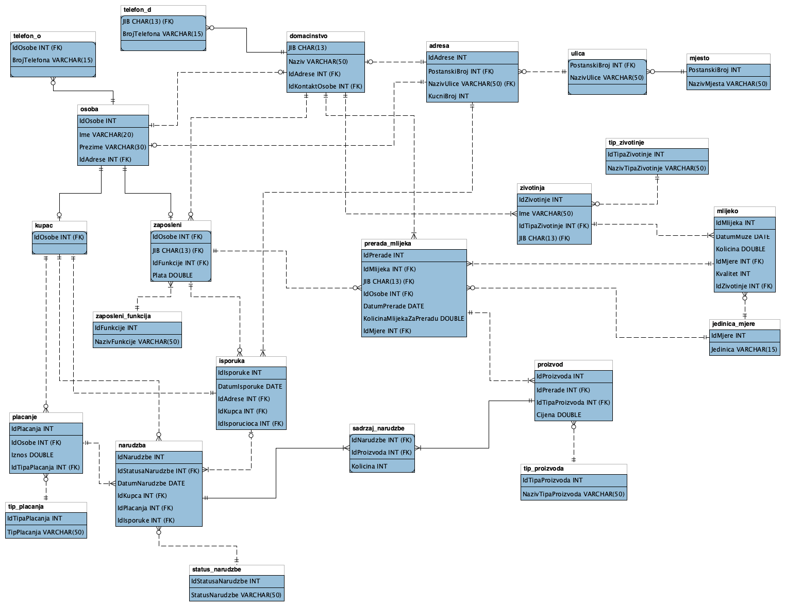

# 🌾 Informacioni sistem za porodično poljoprivredno domaćinstvo "ATOM"

## 📖 O projektu

**Informacioni sistem "ATOM"** je sveobuhvatno softversko rešenje razvijeno u okviru projektnog zadatka iz predmeta **Baze podataka** na Elektrotehničkom fakultetu Univerziteta u Banjoj Luci. 

Cilj sistema je digitalizacija i centralizovano upravljanje poslovnim i proizvodnim procesima poljoprivrednog gazdinstva koje se bavi stočarstvom, proizvodnjom, preradom i prodajom domaćih mliječnih proizvoda (sir, kajmak, mlijeko, jogurt, pavlaka).

Sistem pokriva kompletan proizvodno-prodajni ciklus:
- **Evidencija gazdinstva i resursa**: Praćenje podataka o domaćinstvu, lokacijama i kontakt podacima.
- **Kadrovska evidencija**: Upravljanje zaposlenima, njihovim funkcijama (muža, prerada, isporuka) i platama.
- **Stočni fond i sirovinska baza**: Praćenje životinja (krave, koze) i evidencija dnevnih muža (količina, kvalitet, datum).
- **Proizvodni pogon**: Evidencija procesa prerade mlijeka i dobijenih gotovih proizvoda sa cijenama.
- **Prodaja i distribucija**: Vođenje kupaca, kreiranje narudžbi, specifikacija stavki narudžbe, obrada plaćanja i logistika isporuka.
- **Poslovna analitika**: Generisanje izvještaja o prinosima po grlu stoke, najprodavanijim proizvodima i ukupnoj dobiti gazdinstva.

---

## 🏛 Arhitektura sistema

Aplikacija je implementirana primjenom višeslojne arhitekture koja razdvaja korisnički interfejs, poslovnu logiku i pristup podacima:

```
┌────────────────────────────────────────────────────────┐
│             Prezentacioni sloj (JavaFX GUI)            │
│       FXML pogledi + CSS stilovi + MVC Kontroleri      │
└───────────────────────────┬────────────────────────────┘
                            │
┌───────────────────────────▼────────────────────────────┐
│                  Poslovni sloj (Core)                  │
│       Entity modeli + DTO objekti + Servisna logika    │
└───────────────────────────┬────────────────────────────┘
                            │
┌───────────────────────────▼────────────────────────────┐
│              Sloj pristupa podacima (DAO)              │
│  DataAccessFactory ──► MySQLDataAccessFactory          │
│  DAO interfejsi    ──► MySQL DAO Implementacije        │
│  Thread-Safe ConnectionPool                            │
└───────────────────────────┬────────────────────────────┘
                            │ JDBC Konekcija
┌───────────────────────────▼────────────────────────────┐
│               Sloj perzistencije (MySQL)               │
│     Tabele, Relacije, Integriteti, Procedure, Trigeri  │
└────────────────────────────────────────────────────────┘
```

### Ključni obrasci i komponente:
- **DAO (Data Access Object) patern**: Potpuna enkapsulacija SQL operacija kroz interfejse (`OsobaDataAccess`, `DomacinstvoDataAccess`, `NarudzbaDataAccess`, itd.).
- **Abstract Factory patern**: `DataAccessFactory` omogućava fleksibilnu zamjenu izvora podataka (npr. prelazak na drugu bazu podataka).
- **Thread-safe Connection Pool**: Prilagođeni bazen konekcija (`ConnectionPool`) koji optimizuje višekratnu upotrebu JDBC konekcija i minimizuje opterećenje baze.
- **Separation of Concerns**: FXML definiše strukturu korisničkog interfejsa, CSS definiše vizuelni stil, dok kontroleri obrađuju događaje i komuniciraju sa DAO slojem.

---

## 🗄 Konceptualni i relacioni model baze podataka

Baza podataka `inf_sis_atom` dizajnirana je u skladu sa trećom normalnom formom (3NF), osiguravajući integritet i konzistentnost podataka.

<p align="center">
  
</p>

### Glavni entiteti baze:
| Entitet | Opis |
|---|---|
| `domacinstvo` | Osnovni podaci o poljoprivrednom gazdinstvu (JIB, naziv, adresa, kontakt osoba) |
| `osoba` / `telefon_o` | Generalizovani podaci o licima (kontakt osobe, zaposleni, kupci) |
| `zaposleni` / `zaposleni_funkcija` | Radnici gazdinstva, njihove dodijeljene uloge (muža, prerada, isporuka) i plate |
| `zivotinja` / `tip_zivotinje` | Podaci o muznim grlima (krave, koze) i pripadnost domaćinstvu |
| `mlijeko` / `jedinica_mjere` | Evidencija pomuženog mlijeka (datum, količina, jedinica, kvalitet 1-5, životinja) |
| `prerada_mlijeka` | Proizvodni proces prerade određene količine mlijeka od strane odgovornog radnika |
| `proizvod` / `tip_proizvoda` | Finalni mliječni proizvodi (sir, kajmak, jogurt, mlijeko, pavlaka) sa definisanim cijenama |
| `kupac` | Evidencija kupaca sa povezanim adresama i brojevima telefona |
| `narudzba` / `status_narudzbe` | Podaci o narudžbama, datumima i statusima (npr. plaćena, neplaćena) |
| `sadrzaj_narudzbe` | Stavke narudžbe koje povezuju narudžbu i proizvode sa odgovarajućom količinom |
| `placanje` / `tip_placanja` | Evidencija izvršenih uplata (iznos i tip: gotovina, kartica) |
| `isporuka` | Logistika dostave narudžbe kupcu na adresu, dodijeljena zaposlenom isporučiocu |
| `mjesto`, `ulica`, `adresa` | Normalizovana hijerarhija geografskih lokacija i adresa |

---

## ⚡ Uskladištene procedure, pogledi i trigeri

Skripta [`skripte/ddl_procedure_triger_pogled.sql`](skripte/ddl_procedure_triger_pogled.sql) sadrži napredne objekte baze podataka:

1. **Pogled (View) `kolicina_mlijeka_po_zivotinji`**:
   - Agregira i prikazuje ukupnu pomuženu količinu mlijeka po svakoj životinji, spajajući podatke o imenu, tipu grla i evidencijama muže.

2. **Procedura `top_proizvodi_domacinstva`**:
   - Parametri: `(IN p_jib CHAR(13), IN p_limit INT)`
   - Vraća najprodavanije proizvode određenog domaćinstva sortirane po broju prodatih jedinica i ukupnoj zaradi, uzimajući u obzir samo plaćene narudžbe.

3. **Procedura `ukupna_dobit_domacinstva` (sa SQL kursorom)**:
   - Parametri: `(IN pIdStatusa INT, IN p_jib CHAR(13), OUT p_dobit DOUBLE)`
   - Koristi **SQL kursor** (`narudzbe_cursor`) za iterativni prolazak kroz narudžbe datog statusa (npr. plaćene), dinamičko sumiranje stavki svake narudžbe i izračunavanje ukupne dobiti gazdinstva.

4. **Triger (Trigger) `narudzba_default_status_trigger`**:
   - `BEFORE INSERT ON narudzba`
   - Automatski dodjeljuje status `2` ("neplaćena") novoj narudžbi ukoliko status nije eksplicitno zadat.

---

## 💻 Funkcionalnosti aplikacije

Aplikacija nudi intuitivan grafički korisnički interfejs sa bogatim skupom funkcija:

- **Dashboard (Početna scena)**: Brza navigacija kroz sve module sistema.
- **Modul "Domaćinstvo"**: Prikaz i ažuriranje osnovnih podataka o gazdinstvu i kontakt telefonima.
- **Modul "Zaposleni"**: Kompletan CRUD nad radnicima, izbor funkcije (muža, prerada, isporuka) i definisanje plata.
- **Modul "Životinje"**: Evidencija muznih grla stoke (krave, koze) i dodjela gazdinstvu.
- **Modul "Muža (Mlijeko)"**: Unos dnevne muže, ocjena kvaliteta mlijeka (1-5), evidencija količine i datuma.
- **Modul "Prerada mlijeka"**: Evidencija utroška sirovog mlijeka za proizvodnju i dodjela odgovornog radnika.
- **Modul "Proizvodi"**: Katalog gotovih proizvoda sa cijenama po komadu/litru/kilogramu.
- **Modul "Kupci"**: Evidencija klijenata, upravljanje adresama stanovanja i kontakt podacima.
- **Modul "Narudžbe i stavke"**: Kreiranje novih narudžbi, dodavanje proizvoda u korpu, praćenje statusa plaćanja.
- **Modul "Isporuke"**: Raspored dostave narudžbi na adresu kupca sa dodjelom dostavljača.
- **Modul "Izvještaji i analitika"**:
  - Prikaz ukupnih količina mlijeka po životinji (korišćenjem pogleda).
  - Prikaz Top 5 najprodavanijih mliječnih proizvoda (korišćenjem uskladištene procedure).

---

## 📁 Struktura repozitorijuma

```text
.
├── .gitignore                                  # Korenska konfiguracija za ignorisanje privremenih i osetljivih fajlova
├── README.md                                   # Dokumentacija projekta
├── specifikacija_informacionih_potreba.pdf     # Zvanična specifikacija zahteva i potreba projektnog zadatka
├── konceptualni_model/
│   ├── KonceptualniModel_inf_sis_atom.mwb      # MySQL Workbench izvorni model
│   └── KonceptualniModel_slika.png             # Grafički prikaz ER dijagrama
├── skripte/
│   ├── ddl_inf_sis_atom.sql                    # SQL DDL skripta za kreiranje šeme i tabela baze
│   ├── data_inf_sis_atom.sql                   # SQL skripta sa testnim podacima
│   └── ddl_procedure_triger_pogled.sql         # SQL skripta sa procedurama, trigerima i pogledima
└── pilot_aplikacija/
    ├── BP_PROJEKTNI_ZADATAK/                   # Poslovni i DAO sloj (Java backend + testovi)
    │   └── src/
    │       ├── module-info.java
    │       └── org/unibl/etf/
    │           ├── dao/                        # DAO interfejsi i DataAccessFactory
    │           │   └── mysql/                  # MySQL implementacije DAO interfejsa
    │           │       ├── ConnectionPool.java # Upravljanje bazenom konekcija
    │           │       └── ConnectionPool.properties.example # Primer konfiguracije konekcije
    │           ├── entity/                     # Entitetske domenske klase
    │           ├── main/Main.java              # Konzolna demo aplikacija
    │           ├── test/                       # JUnit 5 testovi (DAO, Entiteti, Konekcija)
    │           └── util/                       # Pomoćne klase za bazu
    └── BP_GUI/                                 # Prezentacioni sloj (JavaFX klijentska aplikacija)
        ├── projektni_slike/                    # Resursi i ikonice za korisnički interfejs
        └── src/
            ├── module-info.java
            └── application/                    # JavaFX kontroleri, FXML dijalozi i CSS stilovi
                ├── Main.java                   # Ulazna tačka JavaFX aplikacije
                ├── *.fxml                      # FXML definicije korisničkog interfejsa
                ├── *Controller.java            # Kontroleri scena i dijaloga
                └── *.css                       # Prilagođeni CSS stilovi
```

---

## 🛠 Preduslovi i tehnologije

Za pokretanje i izgradnju projekta potrebno je imati instalirano:
- **Java Development Kit (JDK)**: verzija **17** ili novija
- **JavaFX SDK**: verzija **17** ili novija (ukoliko nije integrisana u JDK)
- **MySQL Server**: verzija **8.0** ili novija
- **MySQL Workbench** (opciono, za pregled i izmjenu `.mwb` modela)
- **IDE**: Eclipse IDE for Java Developers (ili IntelliJ IDEA / VS Code)

---

## 🚀 Uputstvo za instalaciju i pokretanje

### 1. Kloniranje repozitorijuma
```bash
git clone git@github.com:andjela-balaban/household-information-system.git
cd household-information-system
```

### 2. Kreiranje i inicijalizacija baze podataka
Ulogujte se u vaš MySQL server (kroz MySQL Workbench ili terminal) i izvršite SQL skripte **tačnim redoslijedom**:

```bash
# 1. Kreiranje šeme, tabela i relacija
mysql -u root -p < skripte/ddl_inf_sis_atom.sql

# 2. Popunjavanje baze inicijalnim podacima
mysql -u root -p < skripte/data_inf_sis_atom.sql

# 3. Kreiranje pogleda, procedura i trigera
mysql -u root -p < skripte/ddl_procedure_triger_pogled.sql
```

### 3. Konfiguracija konekcije na bazu podataka
U direktorijumu `pilot_aplikacija/BP_PROJEKTNI_ZADATAK/src/org/unibl/etf/dao/mysql/` nalazi se primer konfiguracionog fajla:
1. Kopirajte fajl `ConnectionPool.properties.example` u isti direktorijum pod nazivom `ConnectionPool.properties`:
   ```bash
   cp "pilot_aplikacija/BP_PROJEKTNI_ZADATAK/src/org/unibl/etf/dao/mysql/ConnectionPool.properties.example" \
      "pilot_aplikacija/BP_PROJEKTNI_ZADATAK/src/org/unibl/etf/dao/mysql/ConnectionPool.properties"
   ```
2. Otvorite `ConnectionPool.properties` i prilagodite parametre vašoj lokalnoj bazi:
   ```properties
   jdbcURL=jdbc:mysql://localhost:3306/inf_sis_atom
   username=vas_mysql_username
   password=vasa_mysql_lozinka
   preconnectCount=5
   maxIdleConnections=25
   maxConnections=25
   ```
> [!NOTE]
> Fajl `ConnectionPool.properties` se nalazi u `.gitignore` i nikada se neće poslati na GitHub, čime su vaše lozinke i podaci bezbedni.

### 4. Pokretanje aplikacije
#### Opcija A: Kroz razvojno okruženje (Eclipse / IntelliJ IDEA)
1. Uvezite projekte `BP_PROJEKTNI_ZADATAK` i `BP_GUI` u vaš radni prostor (workspace).
2. Podesite **Java Build Path** tako da `BP_GUI` referencira projekat `BP_PROJEKTNI_ZADATAK`.
3. Dodajte **MySQL Connector/J** (`mysql-connector-j-x.x.x.jar`) u classpath projekta `BP_PROJEKTNI_ZADATAK`.
4. Dodajte **JavaFX biblioteke** u Modulepath/Classpath projekta `BP_GUI`.
5. Pokrenite klasu `application.Main` kao **JavaFX Application**.

#### Opcija B: Konzolni demo
Ukoliko želite da testirate pristup bazi i DAO sloj bez pokretanja grafičkog interfejsa, pokrenite klasu:
- `org.unibl.etf.main.Main`

---

## 🧪 Testiranje

Projekat poseduje sveobuhvatan paket jediničnih testova (**JUnit 5**) smješten u `pilot_aplikacija/BP_PROJEKTNI_ZADATAK/src/org/unibl/etf/test/`:
- **Testovi entiteta**: Validacija konstruktora, setera, getera i `equals`/`hashCode`/`toString` metoda (`DomacinstvoTest`, `NarudzbaTest`, `MlijekoTest`, itd.).
- **Testovi DAO sloja**: Provjera CRUD operacija nad bazom podataka (`DomacinstvoDataAccessImplTest`, `KupacDataAccessImplTest`, `NarudzbaDataAccessImplTest`, itd.).
- **Test konekcije**: `ConnectionTest` verifikuje ispravnost rada `ConnectionPool`-a.

Testove možete pokrenuti direktno iz IDE-a desnim klikom na paket `org.unibl.etf.test` -> **Run As -> JUnit Test**.
